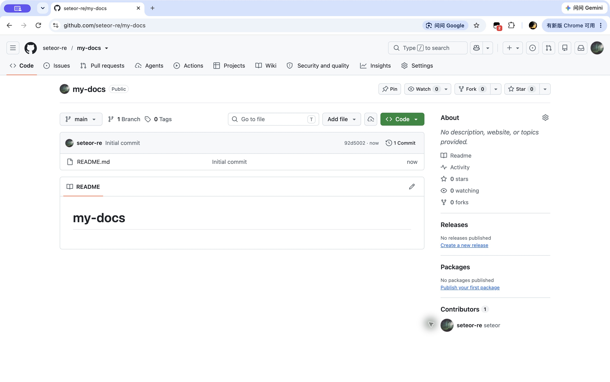
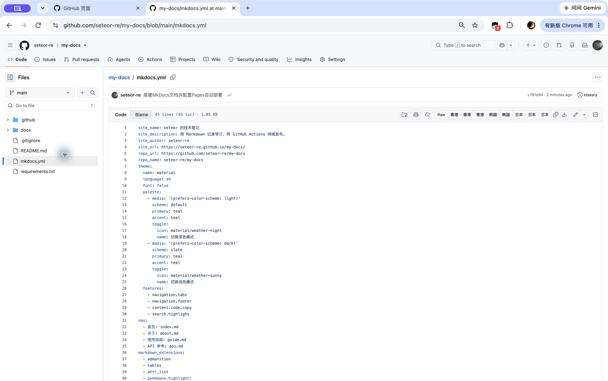
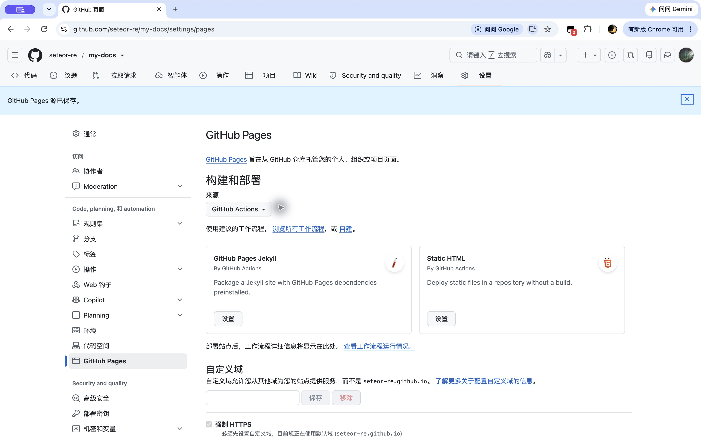
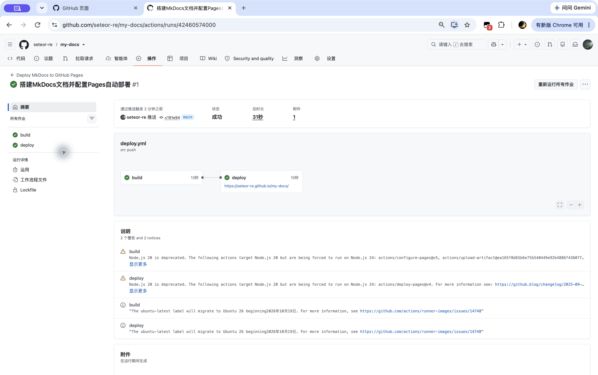
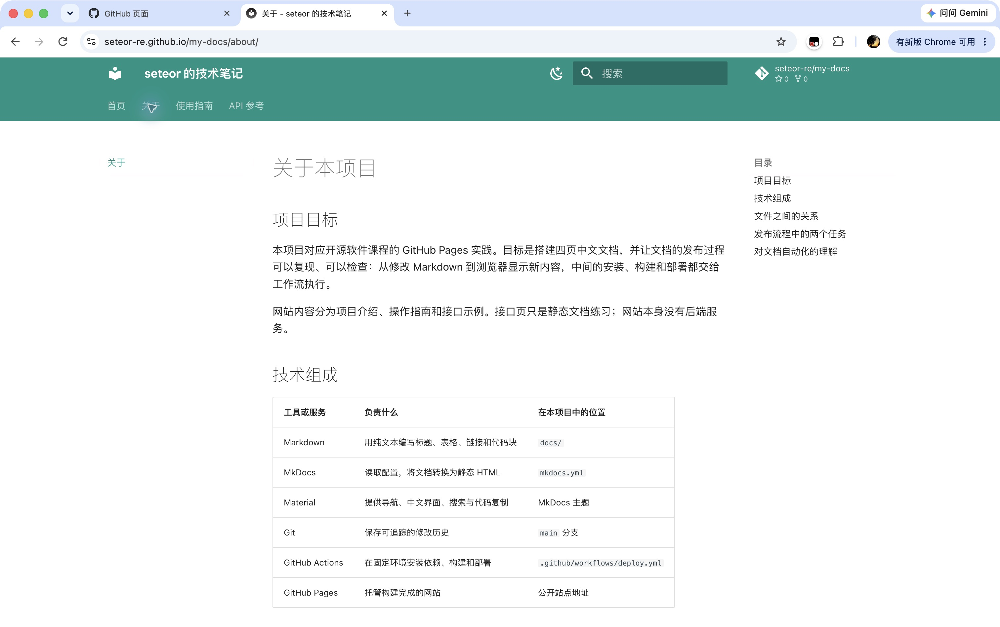
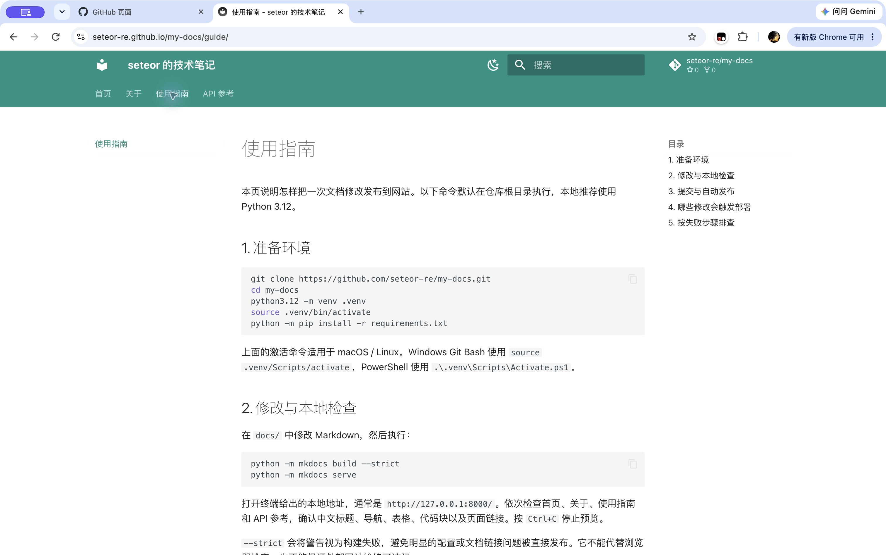
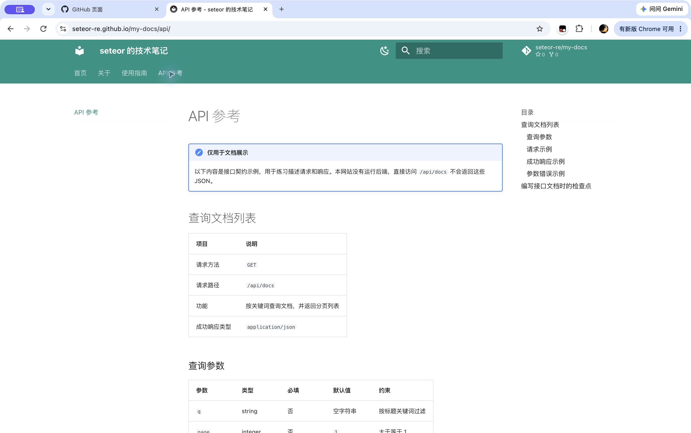
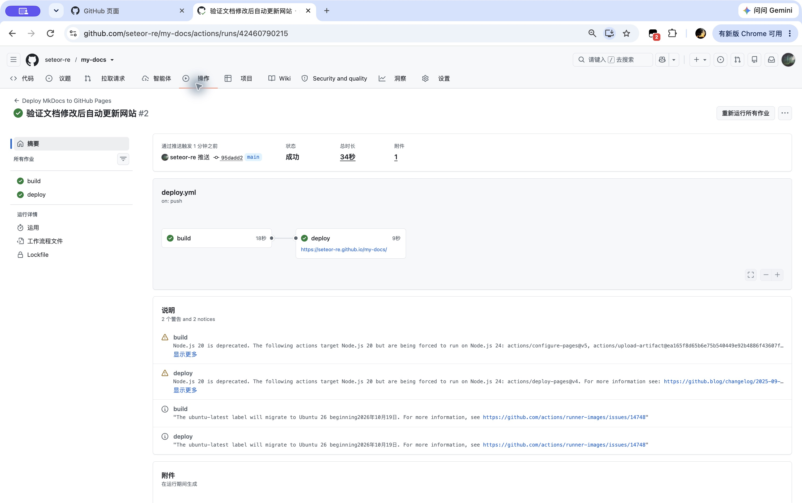

# 实践项目 2：个人实验报告

## 1. 基本信息

- GitHub 登录名：`seteor-re`
- 实践日期：2026 年 11 月 8 日（北京时间）
- 个人源码仓库：[seteor-re/my-docs](https://github.com/seteor-re/my-docs)
- 最终网站：[seteor 的技术笔记](https://seteor-re.github.io/my-docs/)
- 实践主题：通过 GitHub Actions 自动部署 MkDocs 静态文档到 GitHub Pages
- 本次构建环境：Python 3.12.13、MkDocs 1.6.1、MkDocs Material 9.8.1；远程工作流指定 Python 3.12。

本报告记录本仓库的实际构建、部署和访问检查。截图均来自本次操作中的真实页面，未借用其他人的运行记录。

## 2. 实践过程与关键截图

### 2.1 创建个人公开仓库

在本人账号 `seteor-re` 下创建 `my-docs`，选择 Public 并初始化 README。确认默认分支为 `main`，再克隆到本地。这样既满足公开验收要求，也与工作流的分支条件一致。本次直接向个人仓库提交，没有使用组织、协作分组或 PR 审核。

### 2.2 项目结构与 MkDocs 配置

编写 `docs/index.md`、`about.md`、`guide.md` 和 `api.md`。四页分别介绍网站、说明技术组成、列出使用步骤及排错方法、展示 API 契约示例。内容包含表格、HTTP / JSON / Bash 代码块和页面之间的链接，补充了发布流程理解、文档组织思路和接口错误行为。

`mkdocs.yml` 设置了真实仓库地址、带 `/my-docs/` 的网站地址、Material 中文主题及四页导航。页面使用青绿色主题，并提供深浅色切换、搜索和代码复制；`font: false` 避免依赖外部字体服务。

- `docs/`：人工维护的 Markdown 源文件。
- `nav`：决定导航文字和顺序，路径相对于 `docs/`，例如 `index.md`。
- `site/`：构建生成的 HTML、CSS、JavaScript 和搜索索引，不手工维护，也不提交到 `main`。
- `report/`：保存实验说明、实际截图和验证结果。

### 2.3 本地构建与四页预览

本机默认 Python 为 3.14，因此另建 Python 3.12.13 隔离环境。本次通过 uv 安装所需依赖，再用该环境的 Python 执行 MkDocs；在普通 Python 3.12 环境中，可按根目录 README 的 `venv` 和 `pip` 命令复现。

执行 `python -m mkdocs build --strict`，输出 `Documentation built in 0.24 seconds`，成功退出。第二次首页修改后再次严格构建，也成功通过。完整记录见[首次本地构建日志](build-initial.log)和[更新后的本地构建日志](build-update.log)。

启动本地预览后，实际地址为 `http://127.0.0.1:8000/my-docs/`。逐页打开首页、关于、使用指南和 API 参考，核对中文内容、导航、表格、代码高亮及页面间链接。额外检查生成 HTML 中的本地链接和静态资源引用，共 96 处，没有发现缺失目标。

### 2.4 开启 Pages 并设置发布来源

进入个人仓库 `Settings → Pages → Build and deployment`，将 Source 设置为 **GitHub Actions**。界面显示来源已保存。此项目使用官方 artifact 发布方式，没有选择从分支发布，也没有创建 `gh-pages` 分支。

### 2.5 首次构建与部署

将四页文档、站点配置、依赖和 `.github/workflows/deploy.yml` 一起提交并推送到 `main`，触发第一次运行。

- 首次提交：[c191e94：搭建 MkDocs 文档并配置 Pages 自动部署](https://github.com/seteor-re/my-docs/commit/c191e949ea0237a4be48b5b1f51cd6d07752b5da)
- 首次运行：[Deploy MkDocs to GitHub Pages #1](https://github.com/seteor-re/my-docs/actions/runs/42460574000)
- 触发事件：`push`
- 结果：`build` 与 `deploy` 均为 `success`。

`build` 中的源码检出、Python 配置、依赖安装、严格构建与 `site/` 上传全部成功；`deploy` 在构建成功后发布网站，并输出公开地址。

### 2.6 公开网站与四页导航检查

首次发布后，用浏览器打开真实 GitHub Pages 地址，确认网页可以公开访问。再通过顶部导航逐页检查，内容与本地构建一致。

| 页面 | 地址 | 实际检查结果 |
| --- | --- | --- |
| 首页 | [首页](https://seteor-re.github.io/my-docs/) | 标题、作者信息、入口表格和页面链接正常 |
| 关于 | [关于](https://seteor-re.github.io/my-docs/about/) | 工具分工表、目录示例和发布流程说明正常 |
| 使用指南 | [使用指南](https://seteor-re.github.io/my-docs/guide/) | 环境命令、构建命令、触发条件和排错表正常 |
| API 参考 | [API 参考](https://seteor-re.github.io/my-docs/api/) | 示例声明、参数表、请求和 JSON 代码块正常 |

网站四页均返回 HTTP 200，主要 CSS、JavaScript 资源也返回 200；搜索索引可解析，共有 23 个索引条目。机器验证结果保存在 [verification.json](verification.json)，其中记录检查时间、页面与资源地址及状态。

### 2.7 第二次推送与自动更新验证

首次网站访问成功后，在 `docs/index.md` 的首页介绍后新增成功提示框，文字为：

> 从 Markdown 到公开网页：这是 seteor-re 的第二次文档推送，用于验证修改能够自动发布。

仅提交这一次首页修改并推送到 `main`，没有点击手动部署。新的运行记录明确显示由 `push` 触发，`build` 与 `deploy` 再次成功。

- 对应提交：[95dadd2：验证文档修改后自动更新网站](https://github.com/seteor-re/my-docs/commit/95dadd20574e4750f0bc1d3041577a116e0dddf6)
- 对应 Actions：[Deploy MkDocs to GitHub Pages #2](https://github.com/seteor-re/my-docs/actions/runs/42460790215)
- 验证结果：线上 HTML 包含新增文字；浏览器刷新后也能看到绿色提示框。

截图中的 `?v=95dadd2` 用于绕过浏览器缓存，路径仍指向同一个公开首页；正常网站入口无需携带该参数。最后补充报告和截图的提交只涉及 README 与 `report/`，按工作流的路径过滤不会触发网站部署。

## 3. 实际问题与处理

### 3.1 本机 Python 版本不同

本机默认解释器为 Python 3.14，与工作流指定的 Python 3.12 不同。为缩小环境差异，下载 Python 3.12.13，在工作区创建独立虚拟环境并安装依赖。严格构建实际使用的是 Python 3.12.13，没有修改系统默认 Python。

### 3.2 新仓库的插件写入权限不足

向刚创建的仓库写入 Git tree 时，GitHub 插件返回 `403 Resource not accessible by integration`。这是工具对新仓库的访问范围问题。本次改用本机已有的 Git 认证，通过正常的 `git commit` 和 `git push` 提交源码，两次推送均成功。没有把密码或令牌写入配置、报告或工作流。

### 3.3 页面缓存使更新暂时不可见

第二次运行成功后，浏览器最初仍显示旧首页；独立 HTTP 检查已经读取到新内容。使用带提交短编号的查询参数重新访问后，浏览器显示了新增提示框。此处区分了“部署失败”和“旧页面仍在缓存中”，没有因缓存重复执行手动部署。

### 3.4 构建与 Actions 中的提示

本地 Material 9.8.1 输出了主题维护周期提示，但严格构建成功退出。Actions 摘要中有部分 Pages Action 的 Node.js 20 弃用提示，说明运行器强制使用 Node.js 24；另有 `ubuntu-latest` 镜像迁移通知。这些提示没有导致任何步骤失败。核对了两次运行的每个步骤，构建产物上传与 Pages 发布均为成功，并通过公开网站验证结果。

本次保留课程提供的 Action 主版本，不把成功运行误记成“没有任何提示”。后续维护时可以继续关注官方 Action 的更新。

## 4. 原理理解

### 4.1 docs/ 和 site/ 各保存什么？为什么不用手工修改 site/？

`docs/` 保存可读、可编辑、适合版本管理的 Markdown 源文件；`site/` 保存由源码和配置生成的网页、样式、脚本及索引。构建会重新生成 `site/`，手工修改会被覆盖，也不能保证下次构建复现。因此修改应发生在源码和配置中，生成目录由 `.gitignore` 排除。

### 4.2 工作流在什么情况下自动运行？

当推送目标为 `main`，且修改涉及 `docs/**`、`mkdocs.yml`、`requirements.txt` 或 `.github/workflows/deploy.yml` 时自动运行。分支条件和路径条件要同时满足。此外，`workflow_dispatch` 提供手动执行入口，适合首次排错和重试。本次两次验收运行均由 `push` 自动触发。

### 4.3 build 与 deploy 有什么区别？

`build` 负责“把源码变成可以发布的文件”：检出仓库、设置 Python、安装依赖、严格构建，最后上传 `site/` artifact。`deploy` 负责“把已经构建好的产物发布给读者”。`needs: build` 保证部署等待构建成功，避免没有产物就部署。

工作流默认只授予 `contents: read`；部署任务单独声明 `pages: write` 和 `id-token: write`，用于 Pages 发布及身份验证。`github-pages` 环境记录部署及最终 URL，无需手动配置个人访问令牌。

### 4.4 只修改 report/README.md 会触发部署吗？为什么？

不会。该路径不在 `push.paths` 的列表中。报告、截图和根目录 README 不参与 MkDocs 内容构建，单独更新这些文件时无需重新发布网站。如果同一次提交还修改了匹配路径中的文件，则会因那些文件触发运行。

### 4.5 为什么无需创建 gh-pages 分支？

本次使用官方 Pages Actions：构建任务把 `site/` 上传成 `github-pages` artifact，部署任务直接发布该产物。Pages 的 Source 选择 GitHub Actions，不从某个分支读取网站文件，所以不需要另建或维护 `gh-pages` 分支。

## 5. 实践理解

这次记录把“源码已提交”“工作流已成功”和“公开页面已更新”作为三个分别检查的结果。第二次推送尤其有意义：它把新增文字、对应提交和自动运行关联起来，证明整条发布链路可以重复工作。网页截图展示效果，提交历史与运行日志提供可核验的依据，两者一起才能清楚说明发布过程。

## 参考资料

- [课程实践要求](https://github.com/hunnuOpenSourceSoftware2026/assignments/blob/main/02-github-pages.md)
- [GitHub：使用自定义工作流部署 Pages](https://docs.github.com/en/pages/getting-started-with-github-pages/using-custom-workflows-with-github-pages)
- [MkDocs：部署文档](https://www.mkdocs.org/user-guide/deploying-your-docs/)
